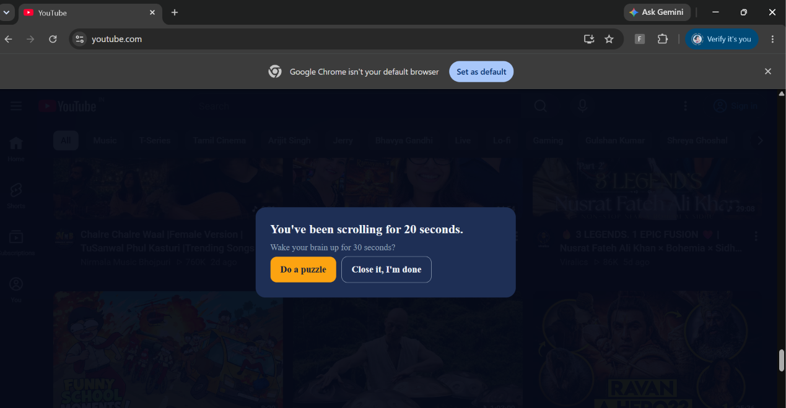

# Focus Flow

A Chrome extension that interrupts doomscrolling and replaces it with a quick brain puzzle.



## The problem

Short-form feeds are built to keep us scrolling, and most of us lose focus without noticing. Many existing tools just block or time-limit apps, but people simply bypass them. Focus Flow takes a different approach: it notices when you have been scrolling continuously, interrupts the loop, and offers something that makes your brain work instead of going numb.

## What it does

- Detects continuous scrolling on Instagram, YouTube and X.
- After a set amount of scrolling, shows a full-screen popup: "You've been scrolling for X."
- Gives you two choices: take a short puzzle, or close the popup and walk away.
- Puzzles are multiple choice (logic, pattern and basic computer science questions).
- A short pause (a few seconds) does not reset the streak, but a real break does.

## How it works

1. `scroll` and `wheel` events record the time of your last scroll.
2. A timer runs every second. If you scrolled in the last 2 seconds, a streak counter goes up. If you stay idle for more than 8 seconds, it resets.
3. When the streak reaches the threshold, the script loads `overlay.html` and displays it on top of the page.
4. A random puzzle is picked from an array, and one button is created per answer option.
5. A correct answer closes the popup and resets the streak.

## Built with

- JavaScript (content script, DOM, events, timers)
- HTML and CSS (popup layout and styling)
- Chrome Extension Manifest V3

## Project structure

```
focus-flow/
├── manifest.json   # extension config (sites, files, permissions)
├── content.js      # scroll detection, timer, puzzle logic
├── overlay.html    # popup structure
├── styles.css      # popup styling (scoped under #ff-overlay)
└── screenshots/
    └── popup.png
```

## Install (for testing)

1. Download or clone this repository:
   ```
   git clone https://github.com/aishanishetty/focus-flow.git
   ```
2. Open Chrome and go to `chrome://extensions`.
3. Turn on **Developer mode** (top right).
4. Click **Load unpacked** and select the `focus-flow` folder.
5. Open Instagram, YouTube or X, refresh the tab, and scroll continuously.

## Settings

At the top of `content.js`:

```javascript
const THRESHOLD_SECONDS = 20;   // seconds of scrolling before the popup (use 600 for 10 minutes)
const IDLE_RESET_SECONDS = 8;   // idle time that resets the streak
```

The threshold is set low for testing. After changing a file, click the refresh icon on the extension card in `chrome://extensions` and reload the website tab.

## Research behind it

The design was shaped by studies on friction-based interventions for smartphone use, including the one sec field experiment (Grüning et al., PNAS 2023) and a longitudinal study of design frictions (Haliburton et al., CHI 2024). Their findings suggest that adding a pause and an easy way to back out reduces app opening, while a message alone does little. Replacing the scroll with a thinking task is less studied, which is what this project explores.

## Status and limitations

- Works on desktop Chrome only, on three sites.
- Detection is a simple rule (continuous scroll time with a pause tolerance), not a model.
- Puzzles are hardcoded and picked at random.
- No stats are saved yet, and it has not been user-tested yet.

## Roadmap

- [ ] Remove repeated puzzles and add more puzzle types
- [ ] Settings popup for the threshold
- [ ] Save simple stats with `chrome.storage`
- [ ] A/B test: friction only vs friction plus puzzle, with friends
- [ ] Smarter detection of autopilot scrolling
- [ ] Android version

## A note on how this was built

I built this project while learning JavaScript, using AI as a tutor and for help with early versions. I then studied the code, debugged it myself using the browser Console, and can explain how each part works.

## Author

Aishani, [@aishanishetty](https://github.com/aishanishetty)
